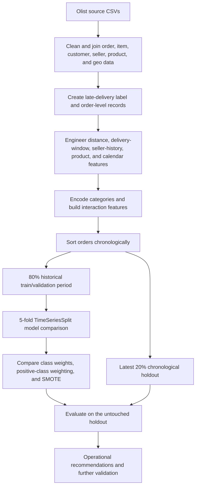

# Predicting Late Deliveries in Brazilian E-Commerce

**A business-focused machine learning project using the Olist Brazilian E-Commerce dataset**

[](https://www.python.org/)
[](https://scikit-learn.org/)
[](https://www.kaggle.com/olistbr/brazilian-ecommerce)

> **Project status: exploratory prototype.** The workflow demonstrates delivery-risk feature engineering and time-aware model evaluation. However, the current held-out test results show weak detection of late deliveries, so the model should not be treated as production-ready without further validation and threshold tuning.

## Executive summary

Late deliveries can reduce customer trust, increase support workload, and make delivery promises less reliable. This project uses historical Olist marketplace orders to investigate whether order, seller, product, timing, and geographic characteristics can help identify orders that may arrive after their estimated delivery date.

The notebook joins several Olist tables, engineers order-level features, and compares Logistic Regression, Random Forest, and XGBoost under different approaches to class imbalance. It uses a chronological train/test split and time-series cross-validation rather than relying only on a random split.

The most important finding is not that the current model is ready to deploy, but that **model selection results do not yet translate into strong performance on later orders**. Class-weighted Logistic Regression achieved the highest cross-validation recall in the notebook (**0.740**), but its held-out test recall was only **0.17** at a probability threshold of 0.60. This gap needs to be investigated before using the predictions for operational decisions.

| Project component | Current implementation / result |
|---|---|
| Prediction target | Late vs. on-time delivery |
| Modeling unit | One row per order after aggregation |
| Final modeling dataset | 95,969 orders |
| Time-based test set | 19,194 orders, dated 26 May–29 August 2018 |
| Main engineered signals | Seller-to-customer distance, delivery windows, seller history, product size/weight, order value/freight, calendar events, product category and customer state |
| Models explored | Logistic Regression, Random Forest, XGBoost |
| Imbalance strategies | No explicit balancing, class weights / positive-class weighting, and SMOTE |
| Current held-out result for late orders | Precision **0.14**, recall **0.17**, F1 **0.15** |
| Overall assessment | Useful analytical baseline; additional validation and model development are required |

## Contents

- [Business background](#business-background)
- [Problem statement](#problem-statement)
- [Dataset and scope](#dataset-and-scope)
- [Analytical workflow](#analytical-workflow)
- [Feature engineering](#feature-engineering)
- [Modeling strategy](#modeling-strategy)
- [Results and interpretation](#results-and-interpretation)
- [Business recommendations](#business-recommendations)
- [Limitations and next steps](#limitations-and-next-steps)
- [Reproducing the analysis](#reproducing-the-analysis)
- [Suggested repository structure](#suggested-repository-structure)
- [References and data attribution](#references-and-data-attribution)

## Business background

Olist is a Brazilian marketplace platform connecting sellers with customers across Brazil. The public dataset contains roughly 100,000 orders from 2016–2018 and related information about orders, items, customers, sellers, products, freight, and geolocation. The dataset is multi-table: one order may contain multiple items, and items in the same order may be fulfilled by different sellers.

Delivery performance is an operational concern because a late order can result in customer dissatisfaction, additional service contacts, and reduced confidence in estimated delivery dates. A useful early-warning system would allow an operations team to investigate risky shipments while there is still time to intervene.

This project focuses on **risk identification**, not on proving the causes of delivery delays. Feature relationships found by a classifier should be treated as predictive associations until they are validated with operational data or controlled interventions.

## Problem statement

The task is a binary classification problem. For each historical order:

\[
\text{late\_delivery} =
\begin{cases}
1, & \text{if actual delivery date} > \text{estimated delivery date} \\
0, & \text{otherwise}
\end{cases}
\]

The objective is to estimate the risk of a late delivery using information that would be available when the order is placed or early in fulfillment. In a live implementation, predictions should be generated before the delivery outcome is known.

### Business questions

1. Can order and logistics characteristics help flag potentially late deliveries?
2. How do geographic distance, promised delivery windows, parcel characteristics, seller history, and seasonal context relate to delivery risk?
3. Does addressing class imbalance improve the model's ability to detect late deliveries?
4. Can the model provide a useful prioritization signal for operations without generating an unmanageable number of false alerts?

## Dataset and scope

**Source:** [Brazilian E-Commerce Public Dataset by Olist on Kaggle](https://www.kaggle.com/olistbr/brazilian-ecommerce).

The notebook primarily joins the following source tables:

| Table | Role in the analysis |
|---|---|
| `olist_orders_dataset.csv` | Order status, purchase timestamp, actual delivery date, estimated delivery date |
| `olist_customers_dataset.csv` | Customer location and ZIP-code prefix |
| `olist_order_items_dataset.csv` | Item-level price, freight, seller, and product references |
| `olist_products_dataset.csv` | Product category, weight, and dimensions |
| `olist_sellers_dataset.csv` | Seller location and seller reference |
| `olist_geolocation_dataset.csv` | ZIP-code prefix to latitude/longitude mapping |

Review and payment files are also loaded as optional inputs in the notebook, but they are not part of the core model feature set described here.

### Data preparation choices

- Rows missing required order timestamps are removed so the target can be derived from observed delivery outcomes.
- Duplicate geolocation ZIP-code prefixes are reduced to one coordinate record before joining.
- Product dimensions are cleaned; missing product categories are grouped as `Other`.
- Customer and seller coordinates are joined to estimate the distance between the two locations.
- Item-level records are consolidated into a single order-level modeling table.

After the notebook's joins and order-level aggregation, the final modeling table contains **95,969 orders**. The time-ordered split reserves the latest 20% (19,194 orders) for testing, covering **26 May–29 August 2018**. The held-out set contains 1,013 late orders and 18,181 on-time orders, so only **5.28%** of the test set is late.

> The target depends on the actual delivery date, so the historical training sample necessarily contains orders with known outcomes. For operational predictions, only pre-delivery features should be supplied; future delivery information must never enter the model inputs.

## Analytical workflow



### Step-by-step approach

1. **Join and clean the data.** Combine order, item, customer, seller, product, and geolocation information, handling missing values and duplicate ZIP-code mappings.
2. **Define the target.** Label an order as late when its actual customer delivery date is after the estimated delivery date.
3. **Engineer logistics and context features.** Calculate seller-to-customer distance and derive shipping windows, promised delivery windows, product dimensions, seller history, and calendar indicators.
4. **Aggregate to order level.** Summarize multi-item orders into order totals and order-level product/geographic features.
5. **Prepare model inputs.** One-hot encode product categories and customer states, construct selected interaction terms, and exclude order ID and timestamp from the feature matrix.
6. **Respect time order.** Sort the records by purchase date; use the first 80% for development and the latest 20% as a holdout. Apply five-fold `TimeSeriesSplit` within the development period.
7. **Compare models and imbalance treatments.** Evaluate baseline, class-weighted, and SMOTE-based variants where implemented.
8. **Review errors on the holdout.** Use the classification report and confusion matrix to assess how well late orders are detected, rather than relying on overall accuracy alone.

## Feature engineering

The notebook creates features in several business-relevant groups.

| Feature group | Examples | Business interpretation |
|---|---|---|
| Geographic / logistics | `distance_km`, `avg_distance_km`, `max_distance_km` | Longer seller-to-customer distances may involve more transit time and more opportunities for disruption. |
| Delivery promises | `shipping_window_days`, `promised_delivery_window_days` | Represents the seller's shipping window and the time allowed between purchase and estimated delivery. |
| Seller history | `seller_historical_orders`, `delayed_orders_by_seller`, `seller_delay_rate`, `seller_avg_delay_days` | Summarizes seller performance based on outcomes known before the order's purchase time. |
| Order / freight | `tot_price`, `tot_freight_value` | Captures the order's commercial value and shipping cost. These are predictive inputs, not proof of a causal relationship. |
| Product characteristics | `sum_product_weight_g`, `sum_product_volumn`, category indicators | Provides a proxy for parcel size, weight, and handling requirements. |
| Time and seasonality | Purchase month, weekday, hour, weekend, public holiday, Carnival, Black Friday, Christmas-period flags | Captures potential demand peaks and calendar-related constraints. |
| Geography and product mix | Customer-state and product-category indicators | Represents regional and category-level differences in the order mix. |
| Interaction terms | Distance × shipping window, seller delay rate × distance, weight × distance, holiday × shipping window | Allows selected combinations of operational factors to have different predictive effects. |

Distance is computed using the Haversine formula from the available latitude and longitude coordinates. Seller-history features are intended to use previously observed delivery outcomes, joined as of the order purchase time. This point-in-time logic is important and should be retained in any refactor.

## Modeling strategy

### Algorithms and imbalance treatments

- **Logistic Regression:** interpretable baseline; also tested with `class_weight="balanced"` and SMOTE.
- **Random Forest:** tested with and without class weighting; an SMOTE variant is recorded in the notebook, but its implementation should be corrected and rerun before its score is interpreted.
- **XGBoost:** tested as a baseline, with `scale_pos_weight` calculated from the training data, and in an `imblearn` pipeline with SMOTE.

The target is imbalanced: late deliveries are much less common than on-time deliveries. This makes recall for the late class particularly relevant if the business cost of missing a risky order is high. However, increasing recall can also produce more false positives, so precision and alert volume must be considered alongside recall.

### Validation design

- Chronological 80/20 development-versus-test split.
- Five-fold `TimeSeriesSplit` during model comparison.
- `random_state=42` in key model and SMOTE components.
- XGBoost and Random Forest hyperparameter searches use `GridSearchCV` with recall as the scoring function.

**Metric-label clarification:** the notebook prints text such as “Best CV PR-AUC,” but the relevant `GridSearchCV` objects are configured with `scoring="recall"`. The values below are therefore **cross-validation recall scores, not PR-AUC**. The README uses the metric actually computed by the code.

## Results and interpretation

### 1. Cross-validation model comparison

The following values are recorded in the notebook's development-period cross-validation. They should be treated as model-selection diagnostics, not as final production performance.

| Model variant | Cross-validation recall | Interpretation |
|---|---:|---|
| Logistic Regression with class weights | **0.7397** | Highest recorded CV recall among the listed variants. |
| Logistic Regression with SMOTE | 0.7024 | Better late-class recall than the unbalanced baseline. |
| Random Forest with class weights | 0.4803 | Class weighting improves recall relative to the unweighted RF run. |
| XGBoost with SMOTE | 0.3840 | Best recorded XGBoost recall variant in these CV runs. |
| XGBoost with `scale_pos_weight` | 0.3200 | Positive-class weighting improves on the unweighted XGBoost run. |
| Logistic Regression without balancing | 0.0933 | Low recall for the minority late-delivery class. |
| XGBoost without balancing | 0.0216 | Very low late-class recall in this imbalanced setting. |
| Random Forest without balancing | 0.0000 | The run did not identify late orders at the evaluated threshold. |
| Random Forest with the recorded SMOTE setup* | 0.0000 | Requires implementation review before the result can be trusted. |

\* In the exported notebook, the Random Forest + SMOTE cell does not clearly apply SMOTE through an `imblearn` pipeline. Rerun this experiment with the sampler inside a pipeline fitted only on each training fold before drawing a conclusion.

**What this suggests:** the imbalance treatment materially changes recall in the current experiments. Class-weighted Logistic Regression is the strongest candidate by the notebook's chosen cross-validation metric, while the unbalanced models largely miss the minority class. This does not, by itself, establish which model is best overall because precision, average precision / PR-AUC, calibration, alert volume, and holdout outcomes must also be compared consistently.

### 2. Held-out test performance

The notebook evaluates the class-weighted Logistic Regression model on the latest 20% of orders, using a probability threshold of **0.60**.

| Test metric | On-time orders (class 0) | Late orders (class 1) |
|---|---:|---:|
| Precision | 0.95 | **0.14** |
| Recall | 0.94 | **0.17** |
| F1-score | 0.95 | **0.15** |
| Support | 18,181 | 1,013 |

Overall test accuracy is **0.90** across 19,194 orders.

### 3. What the test result actually means

- **Late-order detection is weak.** A recall of 0.17 means the model detects only about 17% of late orders at the chosen threshold and misses roughly 83%.
- **The positive predictions are noisy.** Precision of 0.14 means most orders flagged as late are not late in the test set. If every alert requires manual intervention, this may create substantial operational workload.
- **Accuracy is misleading under imbalance.** Since 94.72% of the test set is on time, a naive classifier that predicts “on time” for every order would achieve 94.72% accuracy, although it would detect no late orders. The current model's 90% accuracy is lower than that baseline, so accuracy alone does not demonstrate business value.
- **Cross-validation and holdout results do not agree.** The best recorded CV recall is 0.740, whereas held-out recall is 0.17. The CV estimate and test report also use different classification thresholds (default model prediction in CV versus 0.60 on test), so they are not directly comparable. Threshold selection, temporal changes in late-delivery rates, and implementation details should be investigated.
- **Time matters.** Validation-fold late rates in the notebook vary substantially over time, reaching 19.43% in one fold and falling to 7.10% in the final fold. This variability reinforces the need to monitor drift and evaluate on later periods.

### Result conclusion

The project has a sensible business framing and a useful feature-engineering workflow, but the current test report does **not** justify deploying the model as an automated late-delivery predictor. Its appropriate next use is as a baseline for further experimentation. A stronger version should select its operating threshold using validation data, evaluate all candidate models on the same untouched holdout, and report precision-recall metrics and business costs in addition to accuracy.

## Business recommendations

The following recommendations are hypotheses and operational options informed by the dataset structure and model diagnostics; they should be validated against live fulfillment data before being implemented at scale.

### 1. Use predictions as an operational triage signal

Once a validated model is available, combine a calibrated risk score with transparent rules to create an exception queue for logistics teams. Initially use it to support human review rather than automatically changing customer promises or escalating every flagged order. Track how many true late orders are caught per 100 alerts.

### 2. Improve delivery promises by lane and seller performance

Use historical results to review the delivery windows offered for different seller-to-customer distances and seller reliability levels. If a segment repeatedly misses its promise, examine the assumed transit time, pickup cadence, carrier handoff, and regional fulfillment capacity. Avoid simply extending every delivery estimate, which could protect the on-time metric while worsening the customer experience.

### 3. Strengthen seller-level monitoring

Maintain seller delay rate and average delay severity using only outcomes that were known before each new order. Provide sellers with performance scorecards and prioritize support for sellers with persistent issues. Apply minimum-history thresholds or smoothing so a seller with only a few orders is not judged on an unstable rate.

### 4. Plan for parcel and distance complexity

Review longer-distance lanes and bulky or heavy shipments for routing, consolidation, handling, pickup scheduling, and carrier selection opportunities. The notebook's engineered distance and parcel-size features are useful starting points, but their association with delay should be confirmed with segment-level analysis before assigning operational causes.

### 5. Prepare for seasonal and calendar-related peaks

Use month, weekday, holiday, and promotional-period features to investigate whether fulfillment capacity and carrier performance change around demand peaks. The current dataset ends in August 2018, so it does not test a later Black Friday or Christmas season as a true future holdout. Seasonal readiness should be measured on newer data.

### 6. Measure business impact, not only model metrics

For a pilot, define outcomes such as late deliveries prevented, number of alerts reviewed, false-alert rate, customer contacts, cost per intervention, and on-time delivery improvement versus a control group. These measures will show whether the model changes decisions in a way that creates measurable value.

## Limitations and next steps

Prioritize the following before presenting the model as a deployable solution:

1. **Fix metric reporting.** Rename the current CV output to recall. If PR-AUC is desired, explicitly use `scoring="average_precision"` and report it separately from ROC-AUC and recall.
2. **Use a consistent evaluation protocol.** Compare all shortlisted models on the same untouched chronological holdout and document the exact threshold used for every reported metric.
3. **Tune the threshold on validation data only.** Select it based on the cost of missed late orders versus false alerts; do not use test labels to choose it. Report a precision-recall curve and confusion matrix at the selected threshold.
4. **Fix and rerun Random Forest + SMOTE.** Implement resampling through an `imblearn.pipeline.Pipeline` so synthetic samples are created only from each training fold. Review other notebook cells for stale outputs or code/output mismatches.
5. **Audit temporal and feature leakage.** Keep seller-history features strictly point-in-time. Fit preprocessing and any feature-selection steps on training data only, and split on a clear date boundary so a calendar date is not shared across train and test.
6. **Improve the baseline and calibration.** Compare against simple baselines, inspect score calibration, and report average precision, per-class precision/recall/F1, alert rates, and expected business cost.
7. **Add more recent operational data.** Carrier scans, actual handoff times, warehouse processing, route/transport events, regional capacity, and weather or disruption signals could explain risks that are not observable in the current historical tables.
8. **Check generalization.** Evaluate across later time periods, major Brazilian regions, seller cohorts, and product categories; monitor drift after deployment.

Additional implementation note: the exported notebook uses absolute Windows paths such as `C:/Users/Ed/Desktop/DA/Brazilian E-Commerce/...`. These need to be replaced with repository-relative paths before another person can run the workflow. The choropleth step also downloads a Brazil state GeoJSON file from an external URL, so that visualization requires an internet connection unless the GeoJSON is stored locally.

## Reproducing the analysis

### 1. Download the data

Download the [Olist dataset from Kaggle](https://www.kaggle.com/olistbr/brazilian-ecommerce), review its current license terms, and place the required CSV files in a local data directory. The raw data is not included in this repository.

### 2. Set up the environment

The notebook imports the following third-party packages (exact versions are not pinned in the supplied export):

```bash
pip install numpy pandas matplotlib seaborn scikit-learn xgboost imbalanced-learn statsmodels folium branca requests jupyter
```

### 3. Run the notebook

Open the executable Jupyter notebook and run cells in order. Update the data-loading paths to match your local `data/` directory first. The supplied artifact is an **HTML notebook export**; for a reproducible GitHub repository, include the source `.ipynb` as well as the HTML snapshot if available.

Because resampling and model selection can be computationally intensive, start with the baseline Logistic Regression runs before executing the full XGBoost grid search.

## Suggested repository structure

```text
.
├── README.md
├── notebooks/
│   ├── Brazilian-E-Commerce_v5.1.ipynb   # executable source notebook
│   └── Brazilian-E-Commerce_v5.1.html     # optional rendered notebook
├── data/                                  # local data; do not commit raw files by default
├── outputs/
│   ├── figures/
│   └── metrics/
└── requirements.txt                       # recommended for reproducibility
```

## References and data attribution

1. **Olist.** *Brazilian E-Commerce Public Dataset by Olist.* Kaggle. [Dataset page](https://www.kaggle.com/olistbr/brazilian-ecommerce). The dataset page describes approximately 100,000 Brazilian marketplace orders from 2016–2018 and the related order, customer, item, seller, product, and geolocation tables. Please follow the dataset's current attribution and license terms.
2. **Hartman, N., Sarkar, S., & Alhamadani, A. (2026).** *Learning to Predict Delivery Delays: An Analytical Study of Machine Learning and Oversampling Strategies.* Proceedings of the 2026 9th International Conference on Information and Computer Technologies, pp. 127–135. [https://doi.org/10.1145/3803291.3803322](https://doi.org/10.1145/3803291.3803322). The study compares seven classifiers under manual balancing and SMOTE and reports distance, estimated shipping days, freight value, and item physical score among influential predictors. These findings provide useful context for feature design, but its feature set, sampling setup, and evaluation results differ from this notebook and should not be treated as this repository's performance.

---

*This README documents the supplied notebook export and its recorded results. Metrics should be regenerated after any changes to data preparation, features, resampling, model selection, or decision thresholds.*
