# Predicting Late Deliveries in Brazilian E-Commerce

**A business-focused analytics and machine-learning case study using the Olist marketplace dataset**

[](https://www.python.org/) [](https://scikit-learn.org/) [](https://www.kaggle.com/olistbr/brazilian-ecommerce)

## Executive summary

Late deliveries can erode customer trust, increase customer-service workload, and undermine the reliability of delivery promises. This project uses historical Olist orders to explore which order, seller, product, geographic, and timing characteristics are associated with late delivery, and to test whether those signals can support earlier operational attention.

The project combines exploratory data analysis (EDA), order-level feature engineering, interpretable Logistic Regression, Random Forest and XGBoost experiments, and time-aware validation. Its main value is a **business-oriented view of delivery risk**: delivery-window length, seller-to-customer distance, calendar patterns, and regional differences emerge as useful areas for further investigation. The model is an exploratory baseline rather than a production alerting system; held-out late-order recall is low at the tested threshold, likely reflecting class imbalance, temporal variation, and limited operational signals in the historical data.

### Key takeaways

- Late deliveries represent a minority class (about **8.1%** in the order-level EDA), making recall and precision-recall evaluation more informative than accuracy alone.
- Orders with very short promised delivery windows have a substantially higher observed late rate; the rate also varies by month and geography.
- In the final class-weighted Logistic Regression coefficient plot, **promised delivery window** has the strongest negative coefficient, while **average seller-to-customer distance** and selected regional/month indicators have positive coefficients.
- The corrected Random Forest + SMOTE experiment achieved **0.5933 mean cross-validation recall** using a pipeline, compared with **0.7397** for class-weighted Logistic Regression under the notebook's recall-scoring setup.
- The findings can inform delivery-promise reviews, geographic monitoring, seller scorecards, and the design of an operational risk-triage pilot.

## Contents

- [Business background](#business-background)
- [Business problem and objectives](#business-problem-and-objectives)
- [Dataset and scope](#dataset-and-scope)
- [Exploratory data analysis](#exploratory-data-analysis)
- [Analytical workflow](#analytical-workflow)
- [Feature engineering](#feature-engineering)
- [Modeling and validation](#modeling-and-validation)
- [Results and interpretation](#results-and-interpretation)
- [What the coefficients tell us](#what-the-coefficients-tell-us)
- [Business recommendations](#business-recommendations)
- [Limitations and next steps](#limitations-and-next-steps)
- [Reproducing the analysis](#reproducing-the-analysis)
- [Publishing the interactive map on GitHub](#publishing-the-interactive-map-on-github)
- [Repository structure](#repository-structure)
- [References](#references)

## Business background

Olist is a Brazilian e-commerce marketplace connecting sellers with customers across Brazil. Its public dataset contains approximately 100,000 orders from 2016–2018 and linked information about orders, order items, customers, sellers, products, freight, reviews, payments, and geolocation.

Delivery performance is not determined by one factor alone. The distance between a seller and a customer, time allowed for seller handling and delivery, parcel characteristics, regional conditions, seller operating history, and seasonal volume may all be relevant. Identifying patterns in these dimensions can help an operations team prioritize investigation and evaluate whether delivery promises reflect historical performance.

This project focuses on **identifying patterns and potential risk signals**, not proving that a feature causes a delivery to be late.

## Business problem and objectives

The task is binary classification at the order level:

\[
\text{late\_delivery} =
\begin{cases}
1, & \text{if actual delivery date} > \text{estimated delivery date} \\
0, & \text{otherwise}
\end{cases}
\]

The objective is to estimate late-delivery risk from features that could be available at order placement or early fulfillment, then translate the patterns into operational questions and potential interventions.

The analysis addresses four questions:

1. Which geographic, timing, seller, freight, and product signals are associated with late delivery?
2. How does the observed late rate differ across shipping windows, promised delivery windows, customer states, and purchase months?
3. How do class weights and SMOTE affect the ability of different models to detect the late-delivery class?
4. What operational actions could be informed by the results, and what additional validation is needed before live use?

## Dataset and scope

**Source:** [Brazilian E-Commerce Public Dataset by Olist on Kaggle](https://www.kaggle.com/olistbr/brazilian-ecommerce).

| Source table | Use in this project |
|---|---|
| `olist_orders_dataset.csv` | Purchase and delivery timestamps, order status, actual and estimated delivery dates |
| `olist_order_items_dataset.csv` | Item price, freight, seller and product references |
| `olist_customers_dataset.csv` | Customer location and ZIP-code prefix |
| `olist_sellers_dataset.csv` | Seller reference and location |
| `olist_products_dataset.csv` | Product category, weight and dimensions |
| `olist_geolocation_dataset.csv` | ZIP-code prefix mapped to latitude and longitude |

The notebook joins the tables, engineers item- and order-level variables, and consolidates multi-item orders into a modeling table. The final modeling dataset contains **95,969 orders**. The latest 20% of records is held out chronologically for testing: **19,194 orders from 26 May to 29 August 2018**, comprising 1,013 late and 18,181 on-time deliveries.

Preparation includes date conversion, missing-value handling, reduction of duplicate geolocation ZIP-code records, product-category handling, distance calculation, seller-history features, and one-hot encoding. Order IDs and purchase timestamps are excluded from the model feature matrix; the timestamp is retained separately to preserve chronological splitting.

## Exploratory data analysis

EDA is used to understand the target distribution, order mix, delivery-time features, geographic variation, and changes over time. The figures below are exported from the notebook, with a static preview of the same state-level map data alongside the interactive map HTML.

### 1. Late versus on-time deliveries

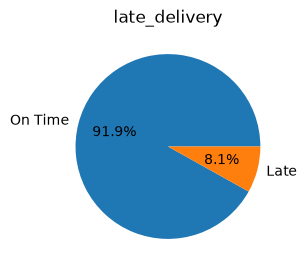

The order-level chart shows approximately **91.9% on-time and 8.1% late deliveries**. That imbalance matters: a classifier can appear accurate by predicting the majority class while failing to identify late orders. The modeling comparison therefore tracks **recall for late orders**, and a future operational evaluation should also track precision, PR-AUC, calibration, and the number of alerts generated.

### 2. Product and geographic distribution

<p align="center">
  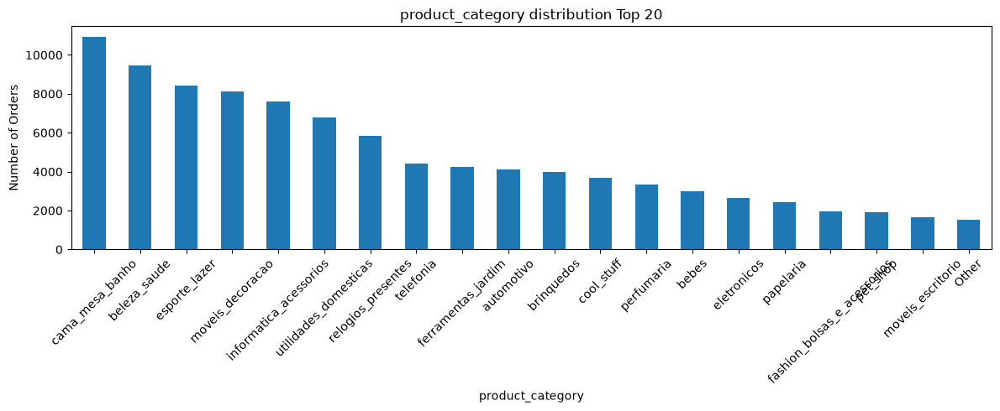
  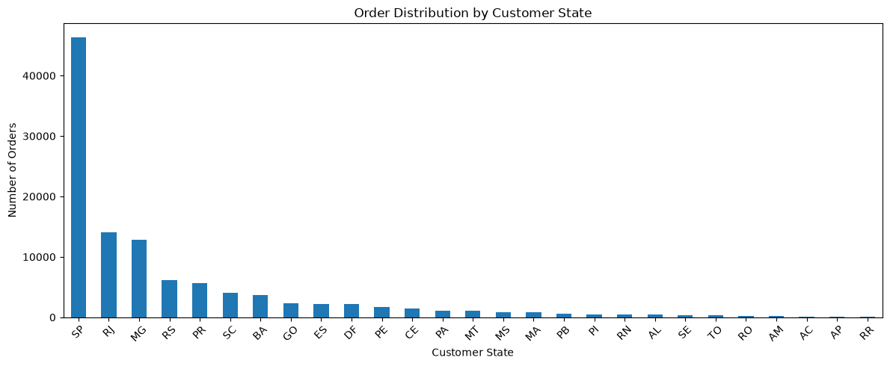
</p>

The category chart is concentrated in categories such as **bed/bath/table**, **health/beauty**, and **sports/leisure**. The state distribution is strongly concentrated in **São Paulo**, followed by other large southern and southeastern states. These are volume charts, not late-rate charts, and the notebook creates them before its final order-level aggregation; counts therefore reflect joined records rather than a clean count of unique orders. Their business use is to show where the data is concentrated and where volume-aware, order-level segment analysis is needed—not to claim that the largest categories or states are necessarily the riskiest.

### 3. Geographic variation in late-delivery rate

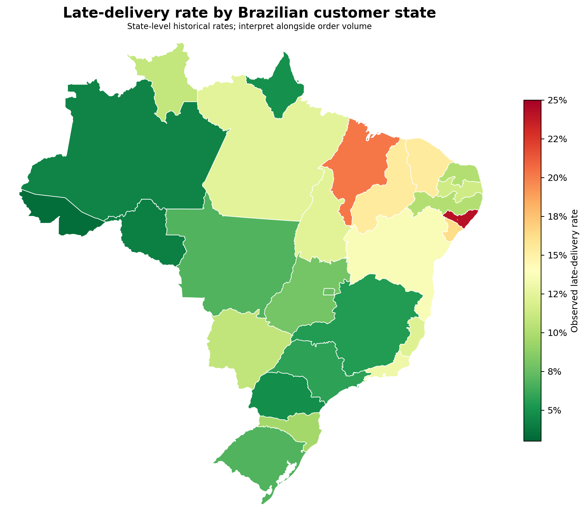

The notebook's exploratory state map shows a wide range of observed rates, from about **3.3% in Acre (AC)** to **24.2% in Alagoas (AL)**. Maranhão (MA) and Sergipe (SE) are also among the higher-rate states in this version of the map. The variation suggests that national averages can hide regional differences and supports further investigation by state and delivery lane.

**Interpretation caveat:** the original notebook calculates the map from `df_full_v1`, before the final order-level aggregation. Multi-item orders can consequently receive more weight than single-item orders, and states have very different sample sizes. Treat this as a geographic exploration, not a final state-performance ranking. Before using it for business decisions, recompute the map from one row per order and show order counts in each state's tooltip.

The notebook's interactive Folium map is included at [`docs/late_delivery_rate_brazil_map.html`](docs/late_delivery_rate_brazil_map.html). See [Publishing the interactive map on GitHub](#publishing-the-interactive-map-on-github) for how to host it so visitors can use the zoom and hover tooltips.

### 4. Distance, purchase timing, and shipping-window distributions

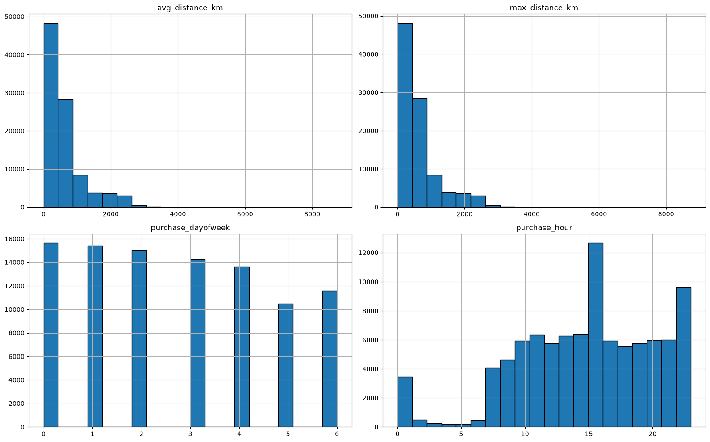

The distributions of `avg_distance_km` and `max_distance_km` are right-skewed: most records fall closer to the lower end, with a long tail of longer-distance deliveries. Purchase counts also vary by weekday and hour, suggesting that order volume is not evenly distributed over the week or day. This motivates checking risk by delivery lane and examining whether staffing and handoff schedules line up with order-arrival patterns.

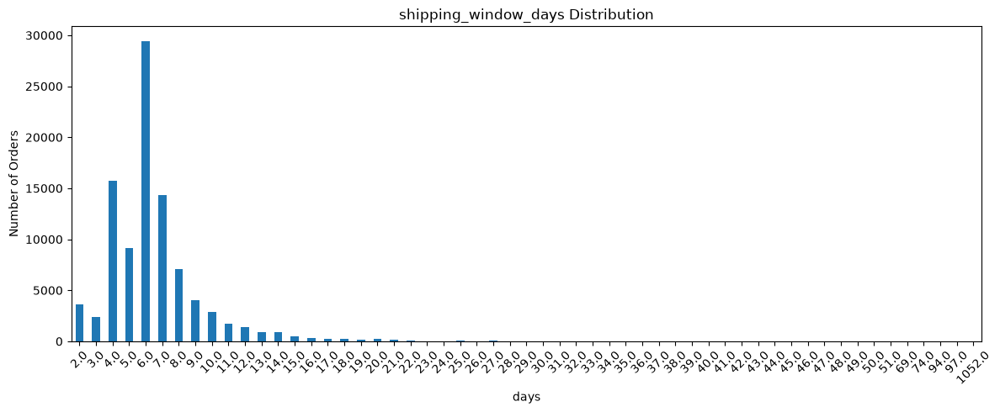

Most `shipping_window_days` values cluster around a few days; the notebook's summary reports a median of roughly **6 days** and a 75th percentile of roughly **7.2 days**. The distribution also contains an extreme tail (the reported maximum exceeds 1,000 days). Such values should be checked for timestamp or data-quality issues before being interpreted as real fulfillment behavior.

### 5. Observed late rate by shipping and promised delivery windows

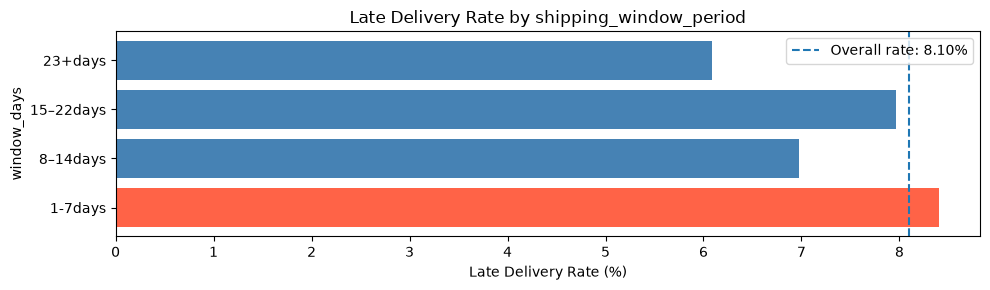

The grouped shipping-window results in the notebook are:

| Seller shipping-window period | Observed late rate |
|---|---:|
| 1–7 days | 8.40% |
| 8–14 days | 6.98% |
| 15–22 days | 7.97% |
| 23+ days | 6.09% |

The pattern is **not monotonic**. The 1–7-day group is slightly above the overall rate (about 8.1%), but the 15–22-day group is also relatively high, while the 23+ day group is lower. This cautions against using seller shipping-window length alone as a simple rule; its relationship may depend on seller, distance, and the promised delivery window.

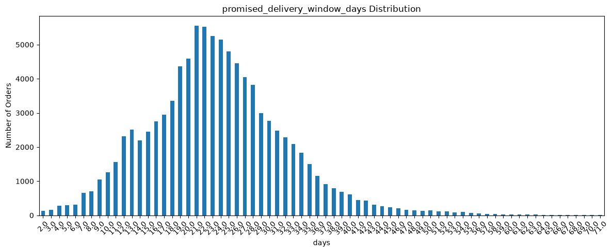

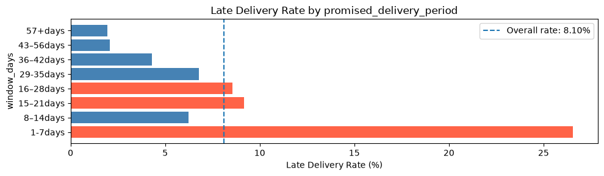

The promised delivery-window chart shows a clearer risk signal: orders given only **1–7 days** have a visibly higher late rate than the overall baseline, while most longer-window groups are lower or closer to the baseline. This fits the operational intuition that a short promise leaves less buffer for delays. The notebook's bucket label `16–28days` does not match its underlying 21–28-day interval; correct this label and check group sizes before quoting exact rates for each bin.

### 6. Monthly variation

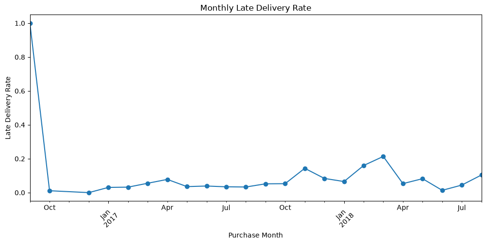

Monthly outcomes vary substantially. In the notebook's order-level monthly table, observed late rates rise to about **14.3% in November 2017**, **16.0% in February 2018**, and **21.4% in March 2018**, before falling to **5.3% in April 2018** and **1.4% in June 2018**. Some early months contain only one or a few records; for example, the 100% rate in September 2016 comes from a single order and should not be interpreted as a stable trend.

This variability helps explain why time-aware validation matters. It also suggests checking historical delivery promises and capacity around higher-risk periods. The chart alone cannot tell us whether the change came from promotions, carriers, seller operations, estimates, or another factor; those causes need more granular operational data.

### EDA synthesis: what should the business take away?

The EDA points to four practical areas: **promise-window design**, **long-distance delivery lanes**, **seasonal monitoring**, and **regional analysis with sufficient sample sizes**. It also shows why one national average and one accuracy score are insufficient. These observations inform the feature engineering and business actions below; they should be validated on the final one-row-per-order data and, ideally, a more recent period.

## Analytical workflow

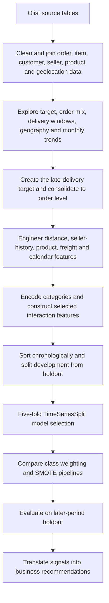

1. **Join and clean:** combine order, item, customer, seller, product, and geolocation information.
2. **Define the target:** flag orders delivered after their estimated delivery date.
3. **Engineer features:** calculate distance and delivery windows; aggregate order items; derive seller history, product size/weight, and calendar indicators.
4. **Prepare inputs:** encode categorical features and create selected interactions between distance, shipping windows, seller history, parcel weight, and calendar flags.
5. **Respect time:** split chronologically and use five-fold `TimeSeriesSplit` within the development period.
6. **Compare imbalance strategies:** evaluate baseline models, class weighting/positive-class weighting, and SMOTE variants where implemented.
7. **Interpret and recommend:** combine model diagnostics with EDA, coefficients, and operational context.

## Feature engineering

| Feature group | Examples from the notebook | Business meaning |
|---|---|---|
| Geographic / logistics | `avg_distance_km`, `max_distance_km` | Seller-to-customer distance as a proxy for lane length and transit complexity. |
| Delivery promises | `shipping_window_days`, `promised_delivery_window_days` | Seller's allowed dispatch window and total promised time from purchase to estimated delivery. These are different concepts. |
| Seller history | `avg_seller_historical_orders`, `avg_delayed_orders_by_seller`, `avg_seller_delay_rate`, `avg_seller_avg_delay_days` | Historical performance signals that should only use outcomes known before the order. |
| Order and freight | `tot_price`, `tot_freight_value` | Order value and total freight charge. |
| Product characteristics | `sum_product_weight_g`, `sum_product_volumn`, category indicators | Parcel size/weight and product-mix proxies. |
| Time and seasonality | Purchase month, weekday, hour, weekend, public holiday, Carnival, Black Friday, Christmas-period flags | Captures time-related variation in demand or operations. |
| Region and category | Customer-state and product-category dummies | Controls for persistent differences between regions and product groups. |
| Interactions | `distance_x_shipping_window`, `seller_delay_x_shipping_window`, `weight_x_avg_distance`, `holiday_x_shipping_window`, `seller_delay_x_distance` | Allows combined patterns to differ from the effect of one feature alone. |

Distance is calculated with the Haversine formula from seller and customer coordinates. Point-in-time discipline is important for seller-history features: only orders whose outcomes were known before the prediction date should contribute to a seller's history.

## Modeling and validation

### Models and imbalance strategies

- **Logistic Regression:** interpretable baseline, evaluated without balancing, with `class_weight="balanced"`, and with SMOTE.
- **Random Forest:** evaluated without balancing, with class weights, and with SMOTE. The SMOTE version has now been corrected to use an `imblearn` pipeline.
- **XGBoost:** evaluated without balancing, with `scale_pos_weight`, and in an SMOTE pipeline.

SMOTE is fitted within each training fold through an `imblearn.pipeline.Pipeline`; this prevents synthetic samples from being generated from validation data. The Random Forest + SMOTE grid uses `TimeSeriesSplit(n_splits=5)` and `GridSearchCV` with **recall** as the scoring metric.

### Validation design

- Chronological 80/20 development/holdout split.
- Five-fold expanding-window `TimeSeriesSplit` in the development period.
- Key stochastic steps use `random_state=42`.
- The holdout is later in time and remains separate from model selection.

**Metric note:** some notebook print statements label `best_score_` as “PR-AUC,” but the grid searches use `scoring="recall"`. Those values are **mean cross-validation recall**, not PR-AUC. The README reports the metric that the code actually computes.

## Results and interpretation

### 1. Cross-validation model comparison

The table below consolidates the recorded model-selection recall scores. The corrected Random Forest + SMOTE result replaces the earlier, incorrectly configured run.

| Model variant | Mean CV recall | Interpretation |
|---|---:|---|
| Logistic Regression with class weights | **0.7397** | Highest recorded recall in the current comparison. |
| Logistic Regression with SMOTE | 0.7024 | Strong minority-class recall in cross-validation. |
| Random Forest with SMOTE (corrected pipeline) | 0.5933 | above the recorded class-weighted Random Forest result. |
| Random Forest with class weights | 0.4803 | Better recall than the unweighted Random Forest run. |
| XGBoost with SMOTE | 0.3840 | Highest recorded XGBoost recall variant. |
| XGBoost with positive-class weighting | 0.3200 | Better than the unweighted XGBoost run. |
| Logistic Regression without balancing | 0.0933 | Misses many late orders at the model's default threshold. |
| XGBoost without balancing | 0.0216 | Very low late-class recall in this imbalanced setting. |
| Random Forest without balancing | 0.0000 | No late orders identified in the recorded cross-validation predictions. |


### 2. Held-out test performance

The current held-out report is from the class-weighted Logistic Regression model using a probability threshold of **0.60**.

| Late-delivery class metric | Test result |
|---|---:|
| Precision | 0.14 |
| Recall | 0.17 |
| F1-score | 0.15 |
| Support (actual late orders) | 1,013 |
| Overall accuracy | 0.90 |

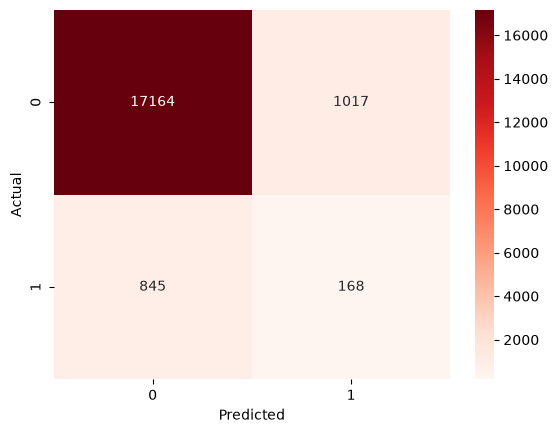

The confusion matrix shows **168 late orders correctly flagged**, **845 late orders missed**, and **1,017 on-time orders incorrectly flagged**. That is not yet an efficient standalone alert system. The gap from cross-validation can plausibly reflect the changing late rate over time, the selected 0.60 test threshold, and the lack of detailed operational inputs such as carrier scans, warehouse handoff times, and real-time route conditions. The project still creates business value by identifying promising risk dimensions and establishing a reproducible baseline for further testing.

## What the coefficients tell us

The notebook's final feature-relationship chart plots the **15 largest absolute coefficients** from the best class-weighted Logistic Regression pipeline, which includes `StandardScaler`. Positive coefficients push the model toward a higher late-delivery score; negative coefficients push it toward a lower score, conditional on the other features. These are predictive associations, not causal effects.

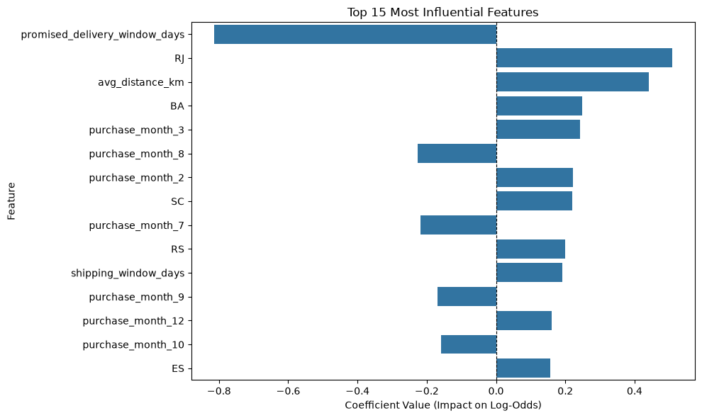

| Feature | Coefficient | Interpretation for the business |
|---|---:|---|
| `promised_delivery_window_days` | **-0.8136** | The strongest negative coefficient. Longer promised windows are associated with a lower modelled late risk; this agrees with the EDA showing higher late rates for very short promises. Review whether the delivery promise leaves enough buffer by lane. |
| `RJ` (Rio de Janeiro) | **+0.5081** | Higher modelled risk relative to the omitted state baseline (`SP`), after controlling for included features. Treat this as a signal for regional investigation, not a claim that the state itself causes delays. |
| `avg_distance_km` | **+0.4414** | Longer average seller-to-customer distance raises the modelled late-risk score. This supports lane-specific transit-time and carrier-performance reviews. |
| `BA` (Bahia) | **+0.2483** | Positive regional association relative to the reference state; validate with order counts and the corrected order-level state analysis. |
| `purchase_month_3` (March) | **+0.2421** | March has a positive coefficient relative to the omitted month baseline, consistent with the observed spike in March 2018. |
| `purchase_month_2` (February) | **+0.2216** | February also has a positive coefficient, aligning with the high observed late rate in February 2018. |
| `SC` (Santa Catarina) | **+0.2196** | Positive conditional regional association relative to the reference state. Investigate route and seller mix before proposing interventions. |
| `purchase_month_8` (August) | **-0.2260** | Lower modelled risk relative to the omitted month baseline in this fitted model; monthly patterns should be checked on later data. |
| `purchase_month_7` (July) | **-0.2183** | Lower conditional model score relative to the month baseline. |
| `shipping_window_days` | **+0.1922** | Positive conditional coefficient for the seller's allowed shipping window. Since the univariate EDA is non-monotonic and interaction terms are included, do not interpret this as a simple rule that every extra day increases risk. |
| `seller_delay_x_shipping_window` | **+0.1375** | The interaction suggests the combination of seller-delay history and shipping-window length carries information beyond either variable alone. |

Other coefficients offer weaker signals in this model: total product weight (+0.0883), historical delayed-order count by seller (+0.0807), total freight value (+0.0738), and total order price (+0.0552) are positive but smaller than the top coefficients. `avg_seller_delay_rate` is close to zero (-0.0084) after controlling for other inputs, so seller history should be investigated as a bundle of signals rather than assuming a single metric will explain delay.

### Combined interpretation

The EDA and coefficients broadly agree on three dimensions:

1. **Delivery promise:** the 1–7-day promised-window group has a higher observed late rate, and the Logistic Regression coefficient for `promised_delivery_window_days` is strongly negative. Review the feasibility of short promises rather than extending all promises indiscriminately.
2. **Geography:** distance is positively associated with modelled risk, while state indicators also vary. Focus diagnostics on lanes and regions, with sample-size checks and carrier/seller mix included.
3. **Time:** observed rates spike in some months and February/March dummies have positive coefficients. Treat calendar periods as planning signals and validate them with newer years before seasonal changes are made.

The product/freight coefficients are smaller in this fitted model than the promise, distance, and some region/time features. This does not rule out handling issues; parcel size and freight may work through interactions or be under-described in the current data.

## Business recommendations

The project is most useful today as an analytics framework and hypothesis generator. Recommended actions:

### 1. Review short delivery promises by lane

Compare promised versus actual delivery outcomes for short-window orders, separated by seller-to-customer distance and region. Identify where a small increase in promised time or a different carrier/service level could be justified, while avoiding blanket extensions that worsen customer experience.

### 2. Build a regional delivery-performance view

Recalculate late rates from one row per order, show both rate and sample count on an interactive map, and segment results by seller origin, customer state, and distance band. Prioritize investigation of regions or lanes with persistently high rates and sufficient volume; do not rank small samples without uncertainty checks.

### 3. Monitor seller performance with point-in-time history

Use seller delay counts, average delay severity, and historical reliability together, applying minimum-history requirements or smoothing for low-volume sellers. Ensure each historical feature includes only outcomes known before the order being scored.

### 4. Plan around higher-risk periods

Use monthly and weekday patterns as a starting point for checking campaign volume, warehouse capacity, seller dispatch, and carrier pickup schedules. The 2017–2018 peaks are historical observations, not proof that the same pattern will recur every year.

### 5. Treat parcel and freight signals as secondary hypotheses

Investigate bulky/heavy parcels and higher-freight orders for special handling, packaging, or carrier constraints. The current coefficients show smaller signals than the delivery-window and distance variables, so test these hypotheses against operational records before allocating resources.

### 6. Pilot a triage workflow, not automatic action

Once performance improves, use a calibrated risk score to prioritize human review. Track true late orders caught per 100 alerts, alert workload, customer contacts, cost per intervention, and late deliveries avoided. A controlled pilot is needed to demonstrate operational value.

## Limitations and next steps

The principal limitation is that the current Logistic Regression test results show weak late-order detection at the chosen threshold. Plausible contributors include temporal changes in the late-delivery rate, class imbalance, and missing real-time logistics signals. The EDA and coefficient findings remain useful for prioritizing further analysis, but should be validated before implementation.

Recommended next steps:

1. Recompute the state map and category performance using **one row per order**, and add sample sizes to the map tooltips.
2. Correct the mislabeled promised-window bucket and investigate extreme shipping-window outliers (including the reported value above 1,000 days).
3. Compare models on the same untouched chronological holdout, using a threshold selected on validation data only; report PR-AUC/average precision, precision, recall, F1, calibration, and alert rate.
4. Audit seller-history features for strict point-in-time availability and retain SMOTE inside training-fold pipelines.
5. Add more recent and granular signals where available: carrier scans, warehouse processing, dispatch/pickup times, carrier/route, regional capacity, and delivery exceptions.
6. Replace absolute Windows paths in the notebook with repository-relative paths and pin dependency versions for reproducibility.

## Repository structure

```text
.
├── README.md
├── notebooks/
│   └── BrazilianE-Commerce_v5.1.html
├── assets/
│   └── figures/
│       ├── eda_late_vs_on_time_share.png
│       ├── eda_top_product_categories.png
│       ├── eda_orders_by_state.png
│       ├── eda_late_delivery_rate_brazil_map.png
│       ├── eda_numeric_feature_distributions.png
│       ├── eda_shipping_window_distribution.png
│       ├── eda_late_rate_by_shipping_window.png
│       ├── eda_promised_window_distribution.png
│       ├── eda_late_rate_by_promised_window.png
│       ├── eda_monthly_late_delivery_rate.png
│       ├── test_confusion_matrix.png
│       └── logistic_regression_top_coefficients.png
├── docs/
│   └── late_delivery_rate_brazil_map.html
├── data/                 # Local raw data; do not commit by default
└── requirements.txt
```

## References

1. **Olist.** *Brazilian E-Commerce Public Dataset by Olist.* Kaggle. [Dataset page](https://www.kaggle.com/olistbr/brazilian-ecommerce). Follow the current dataset license and attribution requirements.


---

*This README documents the supplied notebook export and updated Random Forest + SMOTE result. Regenerate the figures and metrics after changes to data preparation, feature engineering, sampling, model selection, or decision thresholds.*
